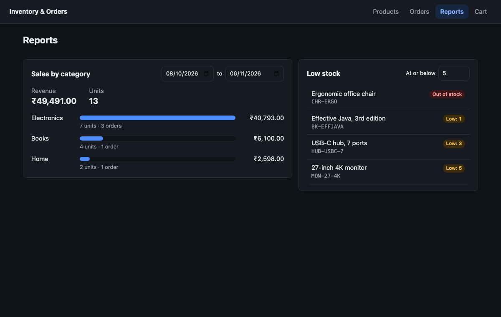

# Inventory & Orders Dashboard

A **React** front end for [inventory-orders-api](https://github.com/Jagadeesh-Udatha/inventory-orders-api), the Spring Boot + MongoDB order service. Store staff can search the catalogue, restock, place orders, move them through their lifecycle and read the sales and low-stock reports.

React 18 · TypeScript · Vite · React Router · TanStack Query · Vitest · React Testing Library · nginx · Docker · GitHub Actions



## Screens

| Route | What it does |
|---|---|
| `/products` | Search, category filter, in-stock toggle, sorting and paging. All filters are kept in the URL, so a view can be bookmarked. Restock inline, add to cart |
| `/products/new` | Add a product. The form checks the same rules as the API (`sku` pattern, price with 2 decimals, ...) before sending, and shows server field errors and `DUPLICATE_SKU` next to the right field |
| `/cart` | Quantities capped by stock on hand; checkout with an `Idempotency-Key` |
| `/orders` · `/orders/:id` | A customer's orders by status; order detail with line snapshots, status history and only the actions the lifecycle allows |
| `/reports` | Revenue and units per category for a date range, plus products at or below a stock threshold |

## How it works

### Safe checkout retries
Each checkout attempt gets one `crypto.randomUUID()` key, sent as `Idempotency-Key`. If the request times out or the server returns 5xx, **Try again** resends the *same* key, so the API returns the order it already created instead of reserving stock twice. Editing the cart starts a new attempt with a new key. A `409 INSUFFICIENT_STOCK` tells the user that nothing was reserved (the API releases partial reservations).

### Errors driven by the API's problem codes
`src/api/client.ts` turns every RFC 7807 response into an `ApiError` with `status`, `code` and `fieldErrors`. Screens react to codes, not message text:

| Code | UI |
|---|---|
| `VALIDATION_FAILED` | Field errors shown under each input |
| `DUPLICATE_SKU` | "SKU already exists" on the SKU field |
| `INSUFFICIENT_STOCK` | Checkout message; the cart stays as it was |
| `ILLEGAL_TRANSITION`, `CONCURRENT_UPDATE` | Order is reloaded so the buttons match what the server now allows |
| network / 5xx | Retry button; 4xx are never retried automatically |

### Server state with TanStack Query
- Query keys mirror the filters (`['products', query]`), so each filter combination is cached separately. `keepPreviousData` keeps the current page on screen while the next one loads.
- Mutations invalidate exactly what they change: a restock refreshes products and low stock, and a cancel refreshes products because stock went back on the shelf.
- Search input is debounced (300 ms) and in-flight requests are cancelled with `AbortSignal` when the query changes.

### Order lifecycle in one place
`src/lib/orderStatus.ts` mirrors the server's `OrderStatus.next()` (PLACED → CONFIRMED → SHIPPED → DELIVERED, cancel before shipping). The server stays the source of truth; a stale screen still gets a 409 and reloads.

### Cart
The cart is a `useReducer` (pure and unit-tested) behind a context, saved to `localStorage`. It never goes above stock on hand or the API limits (100 units a line, 50 lines).

## Run it

Whole stack in Docker (MongoDB + API built from GitHub + this UI behind nginx):

```bash
docker compose up --build
API_URL=http://localhost:3000 ./scripts/seed.sh   # sample products and orders
open http://localhost:3000
```

Against an API you already run on `localhost:8080`:

```bash
npm install
npm run dev           # http://localhost:5173, proxies /api to $API_URL (default http://localhost:8080)
./scripts/seed.sh
```

## Tests

```bash
npm test          # Vitest + React Testing Library
npm run typecheck
npm run build
```

32 tests. Component tests render real pages with a mocked `fetch` router and check what is sent to the API:
- Search, filter and sort parameters; restock; add to cart up to stock.
- Product form validation, server-side duplicate SKU.
- Checkout sends an `Idempotency-Key`, **reuses it on retry after a 503**, and uses a new key after the cart changes.
- Order detail offers only legal transitions, asks before cancelling, and reloads after `ILLEGAL_TRANSITION`.
- Reports send an exclusive end date and render revenue per category.
- Unit tests for the API client, the cart reducer and the lifecycle table.

CI (GitHub Actions) runs typecheck, tests and the production build on every push.
